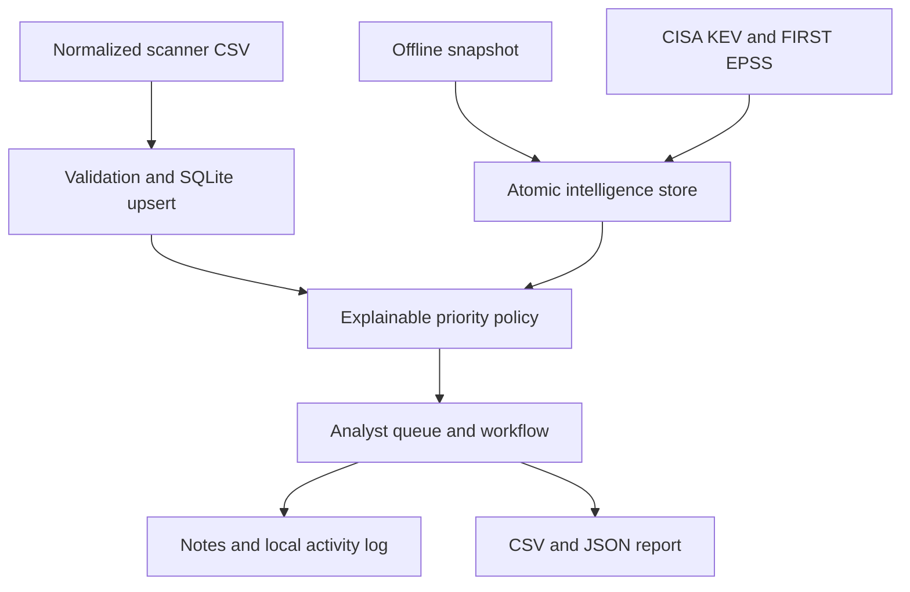

# VulnPilot

[](https://github.com/asif3252/VulnPilot/actions/workflows/tests.yml)


[](LICENSE)

**Vulnerability prioritization and remediation, with the evidence in view.**

A local cybersecurity workbench for importing normalized scanner findings, joining threat intelligence, prioritizing remediation and documenting analyst decisions. Built with Python, SQLite and a responsive HTML/CSS/JavaScript interface. No third-party Python dependencies, cloud account or API key required.

Maintained by [Dr. Muhammad Asif](https://github.com/asif3252).

**[Quick start](#run-on-windows)** · **[Priority policy](#priority-policy-10)** · **[Threat model](docs/THREAT_MODEL.md)** · **[Verification](VALIDATION.md)** · **[Contribute](CONTRIBUTING.md)**

## Clone

```powershell
git clone https://github.com/asif3252/VulnPilot.git
cd VulnPilot
```

## Why this project

Security teams must decide which of many findings deserve limited remediation capacity. A scanner's severity score alone does not describe business importance or exposure. VulnPilot demonstrates a practical vulnerability-management workflow by bringing asset context, CISA Known Exploited Vulnerabilities (KEV), FIRST Exploit Prediction Scoring System (EPSS), ownership and remediation status into one queue.

This is a portfolio prototype with transparent policies, not an enterprise scanner or a validated risk prediction product. It complements network intrusion detection by supporting vulnerability operations before and after detection.

## Run on Windows

Install Python 3.11 or newer, extract this folder, then open Terminal in the folder containing `server.py`:

```powershell
py server.py
```

Open **http://127.0.0.1:8795**. Keep Terminal open. Press `Ctrl+C` to stop. If `py` is unavailable, use `python server.py`.

For a different port:

```powershell
py server.py --port 8796
```

For Linux/macOS: `python3 server.py`. Always use the printed **127.0.0.1** address; the server deliberately rejects other Host values.

## Try the demo

1. Click **Load demo** in an empty workspace.
2. Explore priority distribution, evidence coverage and the queue.
3. Search for an asset or filter by priority/status.
4. Click **Review** to see score components, change status and add analyst notes.
5. Export CSV or a JSON report. Reopen the server to verify persistence.

The demo contains eight fictional findings and fictional `CVE-2099-*` identifiers. Its intelligence is synthetic. It does not represent real vulnerabilities, exploitation evidence or model predictions. Demo loading is rejected when any inventory exists to preserve your work.

## Features

| Workflow | Implementation |
|---|---|
| Findings intake | Strict CSV contract, whole-file validation and transactional upsert |
| Asset context | Business owner, criticality and internet exposure |
| Intelligence | Normalized offline snapshots or explicit CISA/FIRST live lookup |
| Prioritization | Documented score components, priority override and missing-evidence flags |
| Remediation | Five statuses, notes, internal targets and local activity log |
| Reporting | Filterable queue, CSV export and JSON report |
| Privacy | Local SQLite storage; live requests send CVEs, not asset names or notes |
| Engineering | Standard-library tests and a two-version CI workflow |

## CSV import contract

| Column | Required value |
|---|---|
| `asset` | Nonempty asset identifier, up to 200 characters |
| `cve` | CVE identifier such as `CVE-2021-44228` |
| `title` | Nonempty scanner finding title |
| `cvss` | Numeric severity from 0 to 10; use the scanner's validated score |
| `criticality` | Business importance: integer 1 (lowest) through 5 (highest) |
| `internet_exposed` | `true` or `false`; validate reachability separately |
| `owner` | Nonempty team/owner name |

See `samples/demo_findings.csv`. Maximum 2 MB and 2,000 rows per import; 5,000 findings per database. A finding is unique by `(asset, cve)`. Re-import updates descriptive facts but preserves first-seen date, status and notes. Duplicate asset/CVE pairs within one file are rejected. Scanner-specific exports require an explicit adapter; automatic mapping is not implemented. Separate component occurrences sharing the same asset/CVE are consolidated by this identity model.

## Intelligence sources

### Offline snapshot

Import a JSON object with `source`, an ISO `date`, and a `records` array. Each record has a unique `cve`, `kev` (`true`, `false` or `null`) and `epss` (0–1 or `null`). Use `samples/demo_intelligence.json` as a format example, not factual evidence. You are responsible for the accuracy and provenance of imported snapshots. Importing a snapshot replaces previous intelligence atomically.

### Official live refresh

Click **Refresh official feeds**, review the disclosure, then confirm. Requires outbound HTTPS and 1–100 unique CVEs. VulnPilot fetches the complete CISA KEV JSON once and looks up imported CVEs through FIRST EPSS in batches of at most 50. No asset addresses are probed. Only CVE IDs are sent to FIRST. Feed URLs are fixed in code; redirects are rejected rather than followed to an unreviewed destination.

The app validates catalog counts and response completeness. A failed refresh preserves the previous snapshot. A CVE absent from a successfully imported complete KEV catalog is marked “not listed,” not “safe.” Missing EPSS records remain unknown. Source dates and retrieval time remain visible; evidence older than seven days receives a UI caution. Verify upstream dates yourself, especially when KEV and EPSS were published at different times. No background polling runs.

EPSS is FIRST's estimate of exploitation in the wild in the next 30 days, not the chance that your specific asset will be breached. VulnPilot consumes this external model output; it does not train an AI model or claim ownership of EPSS.

## Priority policy 1.0

The transparent triage score is capped at 100:

`score = 3 × CVSS + 5 × (criticality − 1) + 15 × exposed + 25 × KEV + 10 × EPSS`

Boolean terms equal 1 when true. Unknown intelligence contributes no numerical increment and marks the score **provisional**; this conservative accounting of available evidence is not evidence of low risk. Review provisional high-impact assets manually. The weights and thresholds are illustrative, uncalibrated policy defaults, not an industry standard or a statistical risk model.

| Priority | Policy condition | Illustrative internal target |
|---|---|---|
| P1 | Internet-exposed + KEV, or score at least 75 | First seen + 2 days |
| P2 | Score 50–74.99 | First seen + 7 days |
| P3 | Score 25–49.99 | First seen + 30 days |
| P4 | Score below 25 | First seen + 90 days |

Targets recalculate from the original import date when evidence/context changes; these are internal exercise defaults, not CISA deadlines or compliance requirements. “Mitigated,” “Resolved” and “Accepted risk” leave the active backlog, while retained findings remain searchable/exportable. Status changes are analyst assertions; the app does not verify patching. An accepted-risk note is not an organizational approval.

## Architecture



`core.py` owns ingestion, scoring, evidence and persistence. `server.py` exposes a local HTTP API and static assets. `web/` contains the UI. `data/vulnpilot.db` is created at first launch and excluded from source control. The activity log is useful for an exercise but is not tamper-evident and has no authenticated user attribution.

## Tests

```powershell
py -m unittest discover -s tests -v
```

Tests cover workflow persistence across re-import, missing intelligence, priority override, overdue status, malformed input, invalid statuses, snapshot validation, failed refresh preservation, mocked live joins, CSV formula neutralization, demo preservation, security headers, origin/Host checks, API round trips and path traversal. Live upstream availability is not guaranteed by mocked tests. See `VALIDATION.md` for actual verification results.

## Security and limitations

The server binds exclusively to loopback, validates Host/Origin, requires a per-process token for writes, applies a restrictive content security policy and escapes imported strings in the interface. SQL uses bound parameters. CSV exports neutralize leading spreadsheet formulas. It does not execute uploaded content or accept user-supplied feed URLs.

This is a single-user local prototype: no enterprise authentication, encryption at rest, multi-tenant isolation, high-volume ingestion, RBAC, ticketing integration, scanner execution, automatic patching, vulnerability applicability validation or formal audit controls. Anyone with access to your local account/database can inspect or change data. Do not expose this development server through a tunnel or public interface. JSON exports include asset names and notes; handle exports as internal security data. See `SECURITY.md`.

## Market-oriented next milestones

- Audited Nessus, Qualys or Defender adapter with documented field mapping.
- SBOM/CycloneDX ingestion with component identity and applicability checks.
- Jira/ServiceNow integration with a separate approval and credential model.
- SSO/RBAC, immutable audit evidence and managed deployment architecture.
- Historical evidence snapshots and remediation trend reporting.
- Policy configuration and calibration against organizational outcomes.

These are future directions, not implemented features.

## Sources and attribution

- CISA KEV catalog: https://www.cisa.gov/known-exploited-vulnerabilities-catalog
- CISA JSON: https://www.cisa.gov/sites/default/files/feeds/known_exploited_vulnerabilities.json
- FIRST EPSS: https://www.first.org/epss/
- FIRST API: https://api.first.org/epss/
- FIRST data usage guidance: https://www.first.org/epss/data

CISA and FIRST are independent intelligence providers and do not endorse this project. Review their current data terms before redistributing upstream datasets. No real upstream feed is bundled. Source code license: MIT.
